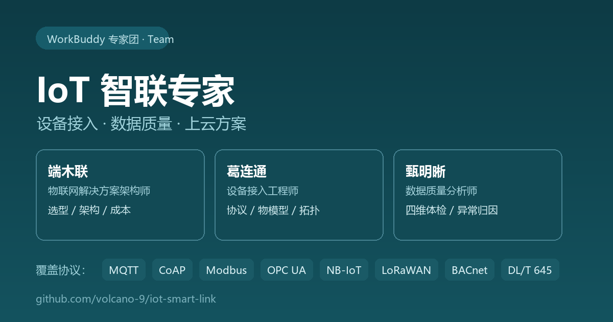
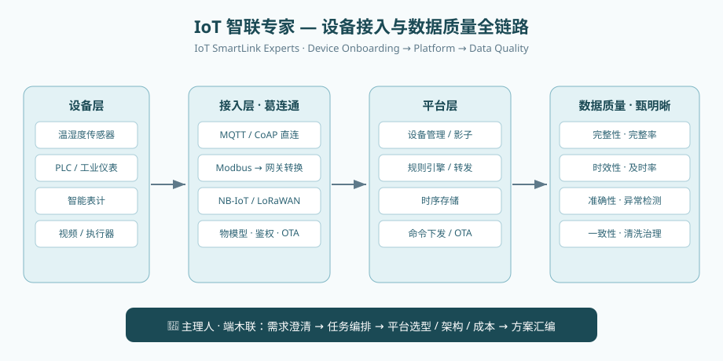

# IoT 智联专家（IoT SmartLink Experts）

**English**: A WorkBuddy expert team for IoT — device onboarding (protocol selection, thing model, gateway topology), device data quality inspection (completeness / timeliness / accuracy / consistency) and end-to-end IoT cloud solution consulting. Team of three: Duanmu (lead, solutions architect), Ge (device connectivity engineer), Zhen (data quality analyst).

物联网全链路专家团队：覆盖设备接入、设备数据质量检查与端到端 IoT 上云方案咨询。





## 类型

Team 型（多角色协作团队）

## 团队构成

| 成员 | 名字 | 职责 |
|------|------|------|
| 主理人 | 端木联（物联网解决方案架构师） | 需求澄清、任务编排、平台选型、架构与成本综合、最终方案汇编 |
| 团员 | 葛连通（设备接入工程师） | 协议选型（MQTT/CoAP/HTTP/Modbus/LoRa/NB-IoT）、物模型设计、接入拓扑、安全接入、批量接入与 OTA |
| 团员 | 甄明晰（数据质量分析师） | 数据完整性/时效性/准确性/一致性四维体检、异常检测、问题归因、数据治理建议 |

## 功能

1. **设备接入实施**：设备画像 → 协议选型 → 接入拓扑（直连/网关/边缘）→ 物模型设计 → 安全方案 → 分步实施清单
2. **数据质量体检**：四维量化体检（完整性/时效性/准确性/一致性）→ 问题归因 → P0/P1/P2 影响分级 → 治理建议
3. **端到端上云方案咨询**：平台选型、架构设计、成本估算，接入与数据两路并行分析后综合输出

## 使用示例

- 我想把一批传感器设备接入物联网平台，帮我选择接入协议并设计物模型。
- 帮我检查设备上报数据的质量，找出缺失、迟到和异常数据。
- 帮我设计一个智慧工厂的物联网上云方案，包括平台选型、架构与成本估算。

## 输出示例（节选）

```markdown
## 二、质量总评
**评级：中**。30 台温湿度传感器 11-01–11-07 应上报 302,400 条，实收 286,455 条，
整体完整率 94.7%（未达 95% 良线），主要受 3 台设备周期性断档拖累；
异常率 0.8%（阈值 <1% 为良），集中在 2 台湿度传感器疑似卡值。

## 三、四维体检结果（所用阈值：完整率 ≥98% 优 / ≥95% 良；异常率 <1% 良）
| 维度 | 指标 | 数值 | 结论 |
|------|------|------|------|
| 完整性 | 完整率 | 94.7% | 3 台设备每日 02:00-03:00 断档，疑定时重启 |
| 时效性 | 及时率（延迟≤5s） | 99.2% | 优 |
| 准确性 | 异常率 | 0.8% | 2 台湿度连续 60+ 周期恒为 65.0%，疑似卡值 |
| 一致性 | 重复上报 | 1,204 条 | 集中于网络抖动时段，建议 QoS 0→1 |
```

## 适用边界（不适合用来做什么）

- **不做硬件选型与报价**：可给出参数要求与成本量级，但不替代采购询价与供应商议价
- **不做私有协议逆向与固件开发**：私有协议需厂商提供接口文档，本专家不负责逆向
- **不替代现场施工与合规评估**：电气安全、等保测评、消防联动验收等需专业机构
- **不提供厂商未公开的内部接口细节**：涉及具体云平台时按公开文档口径给参数
- **不做生产安全闭环控制决策**：涉及人身/设备安全的控制动作必须由人工确认

## 头像

头像已自动生成在 `avatars/` 目录下。如需替换为自定义头像，要求：
- 格式：PNG（推荐）或 JPG
- 尺寸：512×512 px
- 大小：单张不超过 500KB

## 安装

将专家包目录放到专家目录下：

```
C:\Users\zhiyuan.guo\.workbuddy\plugins\marketplaces\my-experts\plugins\iot-smart-link\
```

然后运行注册命令使其可见：

```bash
python3 scripts/register_expert.py <expert-dir>
```

## 打包分享

```bash
python3 scripts/package_expert.py <expert-dir>
```
